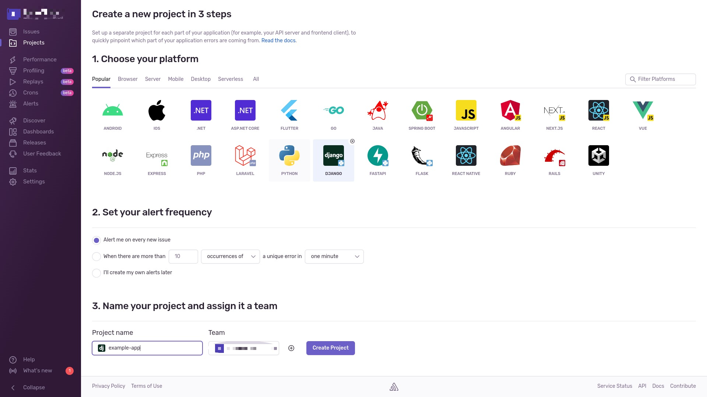
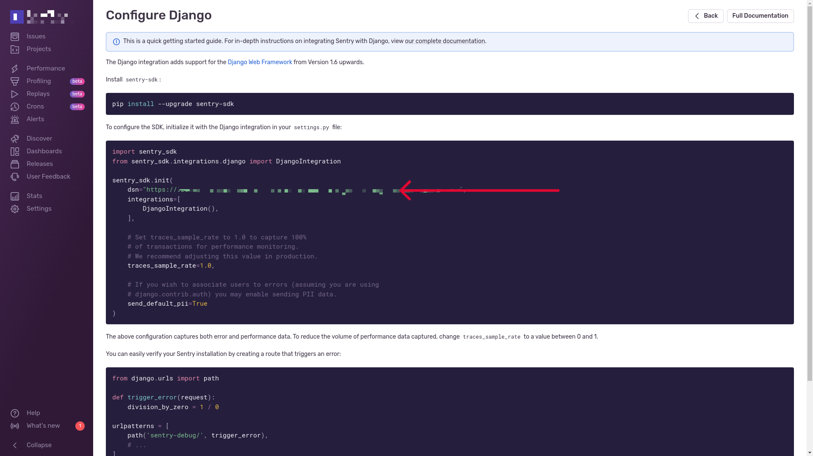

# Deployment
Peachjam can be deployed to a server that has [Dokku](https://dokku.com/) installed. This allows for easy config based deployments using Docker containers.
The following steps outline the procedure to deploy a new Peachjam based application.

## Create an AWS S3 bucket

- [Create an AWS S3 bucket](https://docs.aws.amazon.com/AmazonS3/latest/userguide/creating-bucket.html). The bucket
  does NOT need any special permissions or public access.
- [Create an IAM user](https://docs.aws.amazon.com/IAM/latest/UserGuide/id_users_create.html#id_users_create_console)
  and apply the inline policy below to grant the user read/write access to the bucket.
- **Note:** change `BUCKET` in the example policy to your bucket name:

IAM policy:

```json
{
    "Version": "2012-10-17",
    "Statement": [
        {
            "Sid": "VisualEditor0",
            "Effect": "Allow",
            "Action": [
                "s3:ListAllMyBuckets"
            ],
            "Resource": "*"
        },
        {
            "Sid": "VisualEditor1",
            "Effect": "Allow",
            "Action": "s3:*",
            "Resource": [
                "arn:aws:s3:::BUCKET",
                "arn:aws:s3:::BUCKET/*"
            ]
        }
    ]
}
```

## Private media storage and CORS

Configure CORS **before enabling signed document redirects** on a deployment.
The PDF viewer fetches the stable document `/source.pdf` URL, then follows its
redirect to S3 or R2. This is a cross-origin browser request: a valid signature
alone is insufficient unless the final storage response allows the website's
origin. Django's CORS middleware cannot add headers to responses served by S3/R2.
A download opened directly in a browser tab may work while the inline viewer fails.

### Storage and origin configuration

Use Peachjam's S3 storage backend with `AWS_QUERYSTRING_AUTH = True`,
`AWS_QUERYSTRING_EXPIRE = 300`, and `AWS_S3_CUSTOM_DOMAIN = None`, as configured in
`peachjam.settings`. For R2, configure the account's S3 API endpoint and R2
credentials. Native R2 signed URLs use the S3 API hostname, not a public custom
domain. Keep public-access configuration separate from CORS configuration.

Document redirects are browser-private, with `max-age` set to
`max(0, AWS_QUERYSTRING_EXPIRE - 60)` and `must-revalidate`. Configure Cloudflare to
respect these headers; do not force shared caching or stale serving of redirects.
Keep stable named Django URLs in pages and metadata so cached HTML does not embed
expiring storage URLs. See [media URL guidance](ARCHITECTURE.md#media-urls-and-private-storage).

For each bucket that can serve a document, allow its consuming website origins:

- Use exact origins including scheme and any non-default port, such as
  `https://example.org`, without a path or trailing slash.
- Include every website that fetches content from a shared bucket. Source files
  can reference a different bucket from the deployment's default bucket.
- Sites redirect `www` to the canonical hostname, so `www` origins are unnecessary.
  Add other hostnames only if they actually serve pages that fetch these files.
- Allow `GET` and `HEAD`, the `Range` request header, and a 3,600-second CORS
  preflight cache. This preflight lifetime is independent of signed URL expiry.
- CORS does not grant object permissions or make a bucket public. Signed requests
  still require valid credentials/signatures. Do not change policies, ACLs, public
  access, custom domains, or replication while applying a CORS-only update.

Inspect and back up existing rules before changing them. The update commands below
replace the entire CORS policy: merge the required rule into the saved policy and
preserve existing origins and other rules. Do not replace an existing wildcard
rule with a narrower rule as an incidental part of this setup.

### Delivering downloads from an R2 mirror

Where uploads are stored on S3 and copied to R2, configure a download-only bucket
mapping in the site's settings:

```python
R2_DOWNLOAD_BUCKETS = {**R2_DOWNLOAD_BUCKETS, "example-s3-files": "example-r2-files"}
```

The base mapping includes `lawsafrica-gazettes-archive` → `gazettes-archive`.
Extend it in site settings as above; replacing the dictionary drops shared
mappings. R2 credentials must include Object Read access to the shared archive
bucket as well as the site's own mirror.

Both the default `peachjam.storage.S3Storage` and the dynamic S3 backend use this
mapping when generating `.url()`. Saves, reads (including Django-streamed files),
deletes and metadata operations continue to use the original S3 credentials,
endpoint and bucket. Stored file names and object keys do not change. Unmapped
buckets keep normal signed S3 URLs. The mapping does not enable or change copying
between S3 and R2; use the existing mirror process.

Obtain an R2 Access Key ID and Secret Access Key with **Object Read** permission
on the mapped R2 buckets. These are S3 API credentials, not the Cloudflare API
token used by `cf`. Keep them in deployment secrets, separate from AWS credentials.
Configure these environment variables:

- `R2_ACCESS_KEY_ID`: the R2 access key ID.
- `R2_SECRET_ACCESS_KEY`: its secret access key.
- `R2_ENDPOINT_URL`: `https://<ACCOUNT_ID>.r2.cloudflarestorage.com`.

Leave `R2_ENDPOINT_URL` unset to retain S3 downloads. Install the two credentials
first, then set the endpoint to activate R2 URLs on mapped buckets. Once enabled,
missing credentials raise a configuration error rather than using AWS credentials
against R2. R2 signing uses region `auto`, Signature V4, and the same expiry as S3
(`AWS_QUERYSTRING_EXPIRE`). Existing redirect caching remains unchanged.

Before activation, configure R2 CORS as below. After activation, check that a
canonical PDF endpoint redirects to the R2 S3 API hostname and expected mirror
bucket, with a valid signature. Test an unmapped bucket still uses S3 and that an
upload still lands on S3. URL generation does not check object existence or fetch
an object; it makes no network request to either storage service.

### Gazette source URL cleanup

Migration `0329_clear_gazette_source_urls` uses one bulk SQL update to remove
source-file redirects to `gazettes.africa` and `archive.gazettes.africa` (including
`www` variants) where the record belongs to a gazette and its stored file has a
non-empty `s3:lawsafrica-gazettes-archive:` key. The existing file path is used for
signed delivery. Other URLs, buckets, document types and document provenance URLs
are unchanged. The gazette ingestion adapter no longer sets source-file URLs
from the service's `download_url` field. Imported references to existing S3 objects do
not trigger download-filename metadata writes; newly uploaded files retain their
metadata update. This allows read-only access to the shared archive.

Before deploying this migration, back up the affected source-file IDs and URLs,
verify that application credentials can read the archive, and configure CORS for
the consuming website on whichever bucket serves the signed response (S3 or R2).
The update bypasses dynamic file fields and model/storage hooks; it does not check
or modify physical objects. It is idempotent, but its reverse operation is a
no-op: restoring the original URL values requires the backup. After deployment,
clear cached redirects and check an inline gazette PDF through its canonical URL.
Missing files and incorrect MIME types need separate repairs.

### S3 CORS

Use the AWS profile for the account that owns the bucket. To inspect its policy:

```sh
aws --profile <profile> s3api get-bucket-cors --bucket <bucket> > s3-cors.before.json
```

`NoSuchCORSConfiguration` means there is no existing policy; `AccessDenied` means
use credentials authorised for bucket CORS management, not that CORS is absent.

Create `s3-cors.json` with the merged policy. For a bucket with no existing rules:

```json
{
  "CORSRules": [
    {
      "AllowedOrigins": ["https://example.org"],
      "AllowedMethods": ["GET", "HEAD"],
      "AllowedHeaders": ["Range"],
      "MaxAgeSeconds": 3600
    }
  ]
}
```

Review the file, apply it, and read it back:

```sh
aws --profile <profile> s3api put-bucket-cors --bucket <bucket> --cors-configuration file://s3-cors.json
aws --profile <profile> s3api get-bucket-cors --bucket <bucket>
```

The AWS console's CORS editor takes the `CORSRules` array alone, without the outer
object. See [AWS's CORS configuration reference](https://docs.aws.amazon.com/AmazonS3/latest/userguide/ManageCorsUsing.html).

### R2 CORS with the Cloudflare CLI

S3 and R2 bucket policies are independent, including for replicated content.
Configure each bucket that serves browser requests. Inspect the account's buckets,
custom-domain mappings, and existing CORS rules using `cf`:

```sh
cf r2 buckets list --per-page 100
cf r2 buckets domains custom list --bucket-name <bucket>
cf r2 buckets cors get <bucket> > r2-cors.before.json
```

Follow the pagination cursor if the bucket listing has more results. An R2 bucket
name can differ from its S3 source; confirm the mapping rather than assuming it.
Use `--profile <profile>` if a specific Cloudflare auth profile is needed.

Create `r2-cors.json` with the merged policy. The Cloudflare API/CLI format differs
from the S3 format above. For a bucket with no existing rules:

```json
{
  "rules": [
    {
      "allowed": {
        "origins": ["https://example.org"],
        "methods": ["GET", "HEAD"],
        "headers": ["Range"]
      },
      "maxAgeSeconds": 3600
    }
  ]
}
```

Validate the proposed request, apply it, then read it back. `--body` takes the raw
JSON text; the CLI's `--rules` flag instead accepts a JSON array or `@path`.

```sh
cf r2 buckets cors update <bucket> --body "$(cat r2-cors.json)" --dry-run
cf r2 buckets cors update <bucket> --body "$(cat r2-cors.json)"
cf r2 buckets cors get <bucket>
```

See [Cloudflare's R2 CORS API reference](https://developers.cloudflare.com/api/resources/r2/subresources/buckets/subresources/cors/).

### Verification and rollout

1. Read back the CORS policy for every affected bucket and compare it with the
   intended policy. Existing rules must remain intact.
2. Test a preflight request against the actual storage hostname and an object path:

   ```sh
   curl --include --request OPTIONS \
     --header 'Origin: https://example.org' \
     --header 'Access-Control-Request-Method: GET' \
     --header 'Access-Control-Request-Headers: range' \
     'https://<storage-host>/<object-path>'
   ```

   Expect a successful response with `Access-Control-Allow-Origin` matching the
   website (or an intentionally preserved wildcard), allowed methods including
   `GET`/`HEAD`, and an allowed `Range` header.
3. Open a document that renders as a PDF on the website. In browser developer
   tools, verify that the canonical source request redirects to a fresh signed
   URL and the final `GET` succeeds with `Access-Control-Allow-Origin`. A successful
   preflight alone does not prove that the signature or object permissions work.
   Also verify a document containing embedded images.
4. Clear cached pages containing old direct media URLs when deploying the stable
   image routes. If an existing R2 custom domain still serves cached objects with
   old CORS headers, purge the affected cached objects separately; an API policy
   update alone does not refresh those cached responses.
5. When migrating a public bucket to private access, verify signed URLs and
   streamed public images first. Disabling public custom domains or `r2.dev`
   access is a separate, deliberate operation, not part of configuring CORS.

If the browser reports missing `Access-Control-Allow-Origin`, check CORS on the
**final response's bucket** and the exact website origin. A fresh signed request
may also reveal an underlying storage error that the browser masks as CORS. This
is separate from a Cloudflare challenge on the canonical website endpoint.

## Create the dokku app

- SSH into the Dokku host and create the application as follows:

      dokku apps:create <app_name>

- Setup the domain for the application

      dokku domains:set <app_name> <domain_name>

## Configuration

- Add the relevant environment variables using the dokku config:set command. The required configuration values can be found in the env.example file.

      dokku config:set CONFIG1=value CONFIG2=value

### Contact and email addresses

Set **Contact email** in the Django admin's **Site settings** singleton
(`PeachJamSettings.contact_email`). This required field defaults to
`info@laws.africa` and supplies public contact links, terms pages and enquiries.
Configure the site's address after creating a new deployment.

**Admin emails** controls internal recipients for contact-form messages,
document problem reports and MCP feedback. Enter whitespace-separated addresses.
If blank, notifications use Django's `ADMINS`. Contact-form messages also copy
`ADMINS` when site admin addresses are configured.

Set the deployment variable `DEFAULT_FROM_EMAIL` to the approved outgoing sender:

```sh
dokku config:set <app_name> DEFAULT_FROM_EMAIL='"ExampleLII" <info@example.org>'
```

This also sets Django's `SERVER_EMAIL`. Without an explicit value, both default
to the application name with `info@laws.africa`. Changing **Contact email** does
not change the outgoing sender. CustomerIO transactional templates configure
their sender separately.

#### Upgrading from SUPPORT_EMAIL

`SUPPORT_EMAIL` is no longer a runtime setting. When deploying this change:

1. Before deployment, set `DEFAULT_FROM_EMAIL` explicitly if the outgoing sender
   previously relied on `SUPPORT_EMAIL`.
2. Keep `SUPPORT_EMAIL` in the migration process's environment until migration
   `0326_peachjamsettings_contact_email_and_more` has run. It copies the old value
   into **Contact email**, replacing the new model default.
3. Verify **Contact email** in Site settings, then remove `SUPPORT_EMAIL` from
   deployment configuration.

If migration ran without the old variable, enter the address in Site settings
manually; adding the variable afterwards will not rerun migration. Sites that
previously hard-coded their address in terms templates should also configure
**Contact email** explicitly.

### Important
- Set the DJANGO_DEBUG environment variable to true on the first instance to disable ingestors and for initial migrations to run. Set it to false after successfully deploying your application.

### Generate Django Secret Key
- To generate the secret key for your application, run:

      dokku config:set <app_name> DJANGO_SECRET_KEY=$(cat /dev/urandom | tr -dc 'a-zA-Z0-9' | fold -w 128 | head -n 1)

### Setup Sentry Data Source Name (DSN) Key
A `SENTRY_DSN_KEY` environment variable is required for Sentry to start monitoring events in the application you've just created. To get a dsn value:
- Access your Laws.Africa Sentry account, click on **Projects** then **Create Project**:

  


- Upon creating a new Sentry project, a dsn value will be generated automatically. Copy the value and set it as the `SENTRY_DSN_KEY` environment variable for your dokku application.

  

      dokku config:set <app_name> SENTRY_DSN_KEY=<dsn_value>

### Set NGINX Proxy Read timeout
- We need to increase the read timeout for NGINX to prevent timeout for long-running server tasks:

      dokku nginx:set <app_name> proxy-read-timeout 3600s

### Set File Size Upload Limit
- It is necessary for upload of large files and is done by:

      dokku nginx:set <app_name> client-max-body-size 500m

- Regenerate the dokku app's nginx config (only necessary if changed after deploying)

      dokku proxy:build-config <app_name>

## First deployment

### Disable checks (temporarily)
- It is necessary to disable checks on the dokku application you've just created before the first deployment. This will allow migrations, which are set up as a post deployment task, to run.
  They should be re-enabled once the deployment process is completed successfully.

      dokku checks:disable <app_name>

### Git push

**NOTE: this is to be run on your local machine**

- Dokku will build and deploy the application automatically on git push. First add the remote to the git

      git remote add dokku-<app_name> dokku@<your_server_domain>:<app_name>

- To trigger a build and deploy:

      git push dokku-<app_name> <branch_name>:master

### Setup Languages and Countries
- To populate countries and language data in the database you need to run:

      dokku run <app_name> python manage.py setup_countries_languages

### Create Elasticsearch Index
- To create new elasticsearch index run:

      dokku run <app_name> python manage.py search_index --create


### Enable checks
- Re-enable Zero Downtime Deploy Checks on your application by:

      dokku checks:enable <app_name>

## Post-deployment setup

### Setup SSL
- Enable LetsEncrypt for SSL/TLS. Dokku allows easy setup of SSL using the letsencrypt plugin. On the server, install the letsencrypt dokku plugin:

      sudo dokku plugin:install https://github.com/dokku/dokku-letsencrypt.git

- Configure letsencrypt with the Laws.Africa techops email address, to get reminders about renewing certificates:

      dokku config:set --no-restart <app_name> DOKKU_LETSENCRYPT_EMAIL=your@email.tld

- Install the certificate. Before you install the certificate, your website's domain name must be setup and pointing at this server, so that you can prove that you own the domain.

      dokku letsencrypt <app_name>

- Letsencrypt certificates expire every three months. Set up a cron job to renew certificates automatically:

      dokku letsencrypt:cron-job --add

- You can also manually renew a certificate when it's close to expiry:

      dokku letsencrypt:auto-renew

### Enable Background Tasks

Peachjam runs various background tasks as separate processes as the `task` runner specified in the `Procfile`.

On the dokku server, scale up the processes to run these tasks:

    dokku ps:scale <app_name> tasks=1

If tasks are run on a separate dokku host, create a minimal dokku app on that host with the same configuration:

    dokku apps:create <app_name>
    dokku proxy:disable <app_name>

Deploy to the host via git push as before, then scale the tasks process:

    dokku ps:scale <app_name> web=0 tasks=1

### Setup common taxonomies

Most LII websites use a standard taxonomy which helps categorised documents to be made available on AfricanLII's
continent-wide taxonomy collections.

To load these taxonomies, use the following command:

    dokku run <app_name> python manage.py taxonomies --import --root "Case indexes" peachjam/fixtures/taxonomies/environmental.json

    dokku run <app_name> python manage.py taxonomies --import --root "Case indexes" peachjam/fixtures/taxonomies/commercial.json

# Using Cloudflare

Large sites will benefit from Cloudflare, for both caching and for mitigating attacks and stopping naughty bots and crawlers.

## Proxy the site with Cloudflare

This puts the site behind Cloudflare.

- Add the domain to Cloudflare but DO NOT enable DNS proxying, configure DNS only.
- Under SSL/TLS, configure **Full** mode.
- Go to DNS and configure **proxied** for the site's A record (NOT the www record).

## Caching

This will instruct Cloudflare to obey the caching headers the site sends.

Go to Caching, Configuration:

- Caching level: standard
- Browser Cache TTL: respect existing headers

Go to Cache Rules and add a new rule to prevent caching when the request has an `hx-request` header. We need this because
Cloudflare doesn't obey Vary headers.

- Name: Cache most pages
- Custom filter expression
  - Field: request header
  - Operator: does not exist
  - Value: hx-request
- Cache eligibility: Eligible for cache
- Edge TTL: Use cache-control header if present, bypass cache if not
- Browser TTL: Respect origin TTL
- Save

## Preventing crawlers

Configure Cloudflare to ask visitors to prove they are humans for certain content based on URL patters. Commonly
this is done for gazettes and judgments.

### AI Crawl Control

Cloudflare has a handy UI for blocking common crawlers.

Go to AI Crawl Control

- Click Block alongside the bots you want to block

It's recommended to block:

- AI Search
- AI Crawler
- AI Assistant

It's NOT recommended to block:

- Search Engine Crawler

### Preventing bots using a simple path prefix

Go to Security, Security rules:

- Create rule, custom rules
- Give it a name (such as "akn")
- When incoming requests match…
  - Field: URI path
  - Operator: starts with
  - Value: your prefix such as `/akn/` for all documents
- Action: mananged challenge
- Click Deploy

NOTE: for multi-lingual sites, you must add multiple rules for each language prefix, such as `/en/akn/`, `/fr/akn/`.

### Preventing bots using a wildcard path

This is important for sites with multiple languages, for example, where the path prefix can change based on the user's
preferred site language.

Go to Security, Security rules:

- Create rule, custom rules
- Give it a name (such as "gazettes")
- When incoming requests match…
    - Field: URI path
    - Operator: wildcard
    - Value: `/*/akn/*/judgment/` (for example)
- Action: mananged challenge
- Click Deploy
